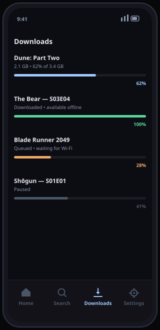
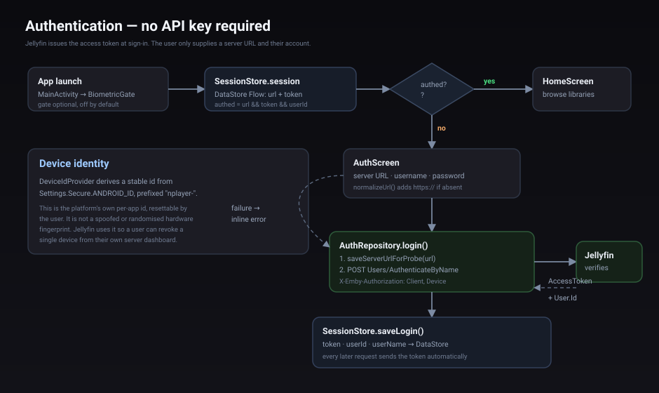
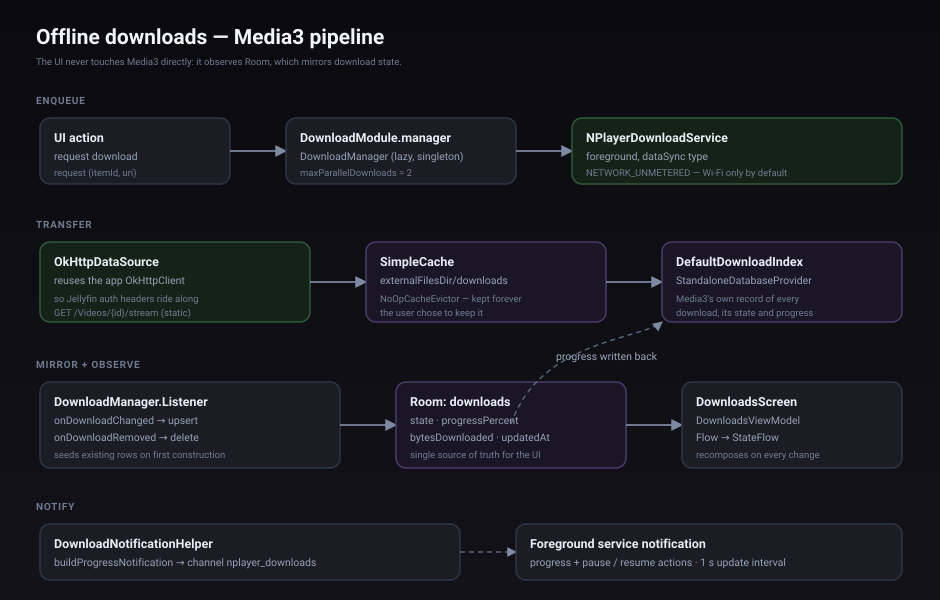

<div align="center">

<picture>
  <source media="(prefers-color-scheme: dark)" srcset="docs/hero-dark.svg">
  <source media="(prefers-color-scheme: light)" srcset="docs/hero-light.svg">
  
</picture>

[](https://github.com/NSKWeb/NPlayer/actions/workflows/android.yml)
[](https://github.com/NSKWeb/NPlayer/releases/latest)
[](LICENSE)
[](#install)
[](NPlayer)
[](NPlayer)

**Kotlin · Jetpack Compose · Media3 · Hilt · Room · min SDK 26**

</div>

---

N Player connects to a Jellyfin instance you host and control. It browses your
libraries, streams or downloads your media, and keeps "Continue watching" in sync
across your devices. It ships no content and talks only to the server URL you enter.

<div align="center">

<picture>
  <source media="(prefers-color-scheme: dark)" srcset="docs/features-dark.svg">
  <source media="(prefers-color-scheme: light)" srcset="docs/features-light.svg">
  
</picture>

</div>

## Install

> [!IMPORTANT]
> **Android 8.0 (Oreo) or newer.** The app targets `minSdk 26`. There is no Play Store
> listing, so every route below is a sideload. iOS is not supported.

<div align="center">


**Scan to download the latest APK**

</div>

| Route | How |
|---|---|
| **Direct download** | Scan the code, or open the [latest release](https://github.com/NSKWeb/NPlayer/releases/latest) *on the phone* and tap `app-debug.apk` |
| **adb** | From a computer with the phone plugged in: `adb install -r app-debug.apk` |
| **Build it** | `cd NPlayer && ./gradlew :app:assembleDebug` — see [Build](#build) |

### On your phone

The direct download is the usual path. Scanning the QR opens
`github.com/NSKWeb/NPlayer/releases/latest/download/app-debug.apk`, which always points
at the newest release asset, so the code never goes stale.

1. **Scan the QR** with the phone's camera, or open the release page in the phone's
   browser. The file lands in **Downloads**.
2. **Tap the downloaded `app-debug.apk`** — from the notification, or Files → Downloads.
3. **Android will refuse the first time.** It shows *"For your security, your phone is
   not allowed to install unknown apps from this source."* Tap **Settings**.
4. **Allow this source.** You land on *Install unknown apps*; enable it for whichever
   app you downloaded with (Chrome, Firefox, Files). Android 8+ grants this
   **per app**, not globally, and only for the app that opens the APK.
5. **Go back and tap Install.** Play Protect may warn that it does not recognise the
   app. Choose **Install anyway** — see the note below for why.
6. **Open N Player** from the launcher, then [connect to your server](#connecting-to-your-server).

> [!NOTE]
> **Why Play Protect warns.** Releases are signed with a debug key, not a published
> release key, so Play Protect has never seen the signature before. The warning is
> about *provenance*, not a detected threat. If you would rather verify the build
> yourself than trust the binary, [build it from source](#build) instead — you get an
> APK you compiled.

### If the install is blocked

| Symptom | Fix |
|---|---|
| *"App not installed"* | An older build with the same application id is present — uninstall it first |
| *"There was a problem parsing the package"* | The download is incomplete. Re-download; check the file is ~25 MB |
| *"Blocked by Play Protect"* | Tap *Install anyway*, or temporarily turn off scanning in the Play Store's Play Protect settings |
| Tapping the APK does nothing | You opened it from a file manager without permission — grant *Install unknown apps* to that file manager |
| Install option is greyed out | Some OEMs also require disabling *MIUI optimisation* / *Auto Blocker*; check the vendor's sideload settings |

The debug build installs as `com.example.nplayer.debug`, so it can sit alongside a
release build without conflict.

## Screens

<div align="center">





</div>

> [!NOTE]
> **These are accurate mockups, not photographs of a running device.** They are
> rendered from the real Compose layouts, theme tokens, and navigation structure. This
> project was built and verified by compilation, lint, and unit tests in a headless
> environment with no KVM, so no emulator screenshot could be captured. The layouts,
> colours, and copy match the code; real screenshots will replace them once the app has
> been run on a device.

## Do I need an API key?

> [!TIP]
> **No.** Jellyfin does not use API keys for client access.

You sign in with a server URL and your normal Jellyfin username and password, and the
server returns an access token that the app stores and reuses. See
[Connecting to your server](#connecting-to-your-server) for the details.

The only key you could generate yourself is a Jellyfin *server* API key
(Dashboard → API Keys). That is for server-side integrations and is **not** used here.

<div align="center">
  
</div>

## Connecting to your server

> [!IMPORTANT]
> **N Player is a client, not a service.** There is no N Player account and no cloud in
> the middle. It talks to a **Jellyfin server you run yourself** — on a NAS, a home
> server, a VPS, or a container. If you do not have one yet, install Jellyfin first;
> the app has nothing to reach until you do.

That is why sign-in asks for a URL, a username, and a password instead of an email
address. Nobody operates a directory of Jellyfin servers for the app to look you up in,
so it has to be told where yours lives and then prove who you are to it.

### Find your server URL

| Where your server runs | What to enter |
|---|---|
| Same Wi-Fi or LAN | `http://<server-ip>:8096` — e.g. `http://192.168.1.10:8096` |
| Behind a reverse proxy | `https://jellyfin.example.com` |
| Docker | The host's LAN IP, **not** `localhost` — `localhost` on a phone means the phone |

The web UI is served from the same address. If `http://<server-ip>:8096` opens
Jellyfin's login page in a browser, that is the URL to type into the app. You can read
the exact address from **Dashboard → Networking** on the server.

The scheme is optional — `media.example.com` becomes `https://media.example.com`. Note
that `192.168.1.10:8096` with no scheme *also* becomes **https**, which a plain LAN
server usually does not answer, so type `http://` yourself for local servers.

> [!WARNING]
> **Cleartext HTTP is opt-in.** The manifest sets `usesCleartextTraffic="false"`, so an
> `http://` server is rejected rather than silently allowed. This is deliberate: a typo
> cannot quietly downgrade you to an unencrypted connection. Type `http://` for a LAN
> server; use TLS for anything reachable from the internet.

### Steps

1. **Install and start Jellyfin.** Note the address shown in Dashboard → Networking.
2. **Open N Player.** It shows the Auth screen on first launch.
3. **Server URL** — your address, e.g. `http://192.168.1.10:8096`.
4. **Username and password** — your normal Jellyfin account. If you only have an admin
   login and would rather not use it on a phone, create a regular user in
   Dashboard → Users.
5. **Sign in.** The app calls `POST /Users/AuthenticateByName`; the server returns a
   token that is stored and reused. No API key, and no re-typing later.

### If sign-in fails

| Message | Likely cause |
|---|---|
| "Could not reach the server" | Wrong IP or port, phone on a different network, a firewall, or `http://` typed without the scheme |
| "Invalid username or password" | Wrong credentials, or the account has a password you left blank |
| "The server returned an error" | The address answers but is not Jellyfin — another service on port 8096, or a proxy misrouting the API paths |
| "Sign-in failed" | The URL resolves to something that is not a Jellyfin server |

Only the URL and username are required to submit, so a passwordless Jellyfin account
works. Everything the app sends goes to your server; see
[Security and privacy](#security-and-privacy).

> [!NOTE]
> **Automatic discovery (UDP 7359) and Quick Connect are not implemented yet**, so the
> server URL is entered by hand. Both are Jellyfin features that could remove most of
> this typing later; manual entry works everywhere and is the current behaviour.

## Screens at a glance

| Screen | What it does | State source |
|---|---|---|
| **Auth** | Enter server URL and credentials; URL is normalised to `https://` when the scheme is missing | `AuthViewModel` |
| **Home** | "Recently added" rail over a library grid of posters | `HomeViewModel` |
| **Detail** | Backdrop, title, year, runtime, synopsis, favourite toggle, Play | `DetailViewModel` |
| **Search** | Server-side search, debounced 300 ms, minimum two characters | `SearchViewModel` |
| **Downloads** | Live progress for everything kept offline | `DownloadsViewModel` |
| **Player** | Media3 `PlayerView` inside Compose, with a back affordance | `PlayerViewModel` |
| **Settings** | Server and account info, light/dark/system theme control, biometric lock toggle, sign out | `SettingsViewModel` |

The bottom bar carries Home, Search, Downloads, and Settings. Detail and Player are
full-screen destinations pushed on top, which is why the bar hides for them.

## Architecture

Four layers, one direction of dependency. Compose talks to ViewModels; ViewModels
talk to repositories; repositories own the network and persistence. Nothing above
the data layer knows about Retrofit, and nothing below the UI layer knows about Compose.

<div align="center">
  
</div>

```
NPlayer/app/src/main/java/com/example/nplayer/
├── data/
│   ├── local/        Room database + DataStore position store
│   ├── prefs/        SessionStore, DeviceIdProvider
│   ├── remote/       JellyfinApi, interceptors, DTOs, Hilt network module
│   └── repository/   Auth + library repositories, ApiResult error mapping
├── di/               Hilt modules (database, DAOs)
├── downloads/        DownloadModule, download service, notifications
├── playback/         PlaybackService, PlaybackController, StreamUrls
├── sync/             LibrarySyncWorker + SyncScheduler
└── ui/               Compose: theme, navigation, components, seven screens
```

### How a request finds the right server

<details>
<summary>Interceptors, and why the API declares only relative paths</summary>


Retrofit is built once against a placeholder origin. The real host is not known
until the user types it, so two OkHttp interceptors do the work at request time:

- **`BaseUrlInterceptor`** rewrites scheme, host, and port onto the stored server
  origin while preserving path and query.
- **`AuthInterceptor`** adds `X-Emby-Authorization` with the client name, device id,
  and — once signed in — the token.
- **`JellyfinImageInterceptor`** does the same for Coil, which fetches artwork
  outside Retrofit.

This is why `JellyfinApi` declares only relative paths. There is no build-time
server baked into the app.

</details>

### Error handling

Every network call runs through one helper:

```kotlin
suspend fun <T> apiCall(block: suspend () -> T): ApiResult<T>
```

It maps `HttpException` and `IOException` onto `NETWORK`, `UNAUTHORIZED`, `SERVER`,
or `UNKNOWN`. Screens switch on that instead of catching exceptions, so a dropped
connection shows an inline retry rather than crashing the UI.

## Playback logic

Playback lives behind a Media3 `MediaSessionService`. The Activity and ViewModel
never hold an `ExoPlayer`; they hold a `MediaController` bound to the service. That
is what gives background playback, the media notification, lock-screen controls,
and correct audio focus for free.

<div align="center">
  
</div>

### Direct play versus transcode

<details>
<summary>The container allowlist, and why it matters</summary>

`StreamUrls` is a pure Kotlin object, which is what makes it unit-testable without
a device. Given a media source it decides:

| Container | Decision | URL |
|---|---|---|
| `mp4`, `mkv`, `webm`, `m4v`, `mov`, `mp3`, `aac`, `flac`, `ogg`, `opus`, `wav`, `m4a` | **Direct play** the original file | `/Videos/{id}/stream?static=true&mediaSourceId=…` |
| anything else, or no media source | **HLS transcode** | `/Videos/{id}/master.m3u8` with `videoCodec=h264&audioCodec=aac&transcodingProtocol=hls` |

Direct play avoids burning server CPU. Transcoding guarantees something playable
when the container is one ExoPlayer cannot demux.

</details>

### Resume position

<details>
<summary>Stored twice — locally and on the server</summary>


Resume is stored twice, on purpose:

- **Locally** in DataStore (`nplayer_positions`) so playback resumes instantly and
  offline. Positions under five seconds are dropped rather than stored.
- **On the server** via `Sessions/Playing*`, so "Continue watching" is correct on
  every other Jellyfin client you use.

`PlaybackController` restores the local position as the start position and then
runs a ten-second loop that saves locally and posts `Sessions/Playing/Progress`.
Leaving the player cancels the loop and posts `Sessions/Playing/Stopped` with the
final position.

Media bytes themselves flow through `OkHttpDataSource`, so the same auth headers
that protect API calls also protect the video stream.

</details>

## Offline downloads

Downloads use Media3's own manager rather than a hand-rolled downloader, so
retry, resume, and constraint handling come from the platform.

<div align="center">
  
</div>

Two design choices are worth calling out:

- **The UI observes Room, not Media3.** A `DownloadManager.Listener` mirrors every
  change into the `downloads` table. Screens read a single Flow, so Media3 types
  never leak upward and the list renders from one source of truth.
- **`NoOpCacheEvictor`.** Downloaded media is never silently evicted. The user asked
  to keep it offline, so only an explicit delete removes it.

Downloads default to `NETWORK_UNMETERED` — Wi-Fi only, so a queue cannot quietly
consume mobile data.

## Background sync

A `LibrarySyncWorker` runs every twelve hours, constrained to a connected network,
and writes a lightweight snapshot of the latest sixty items into Room. `pruneOlderThan`
removes cached rows untouched for thirty days, excluding anything downloaded.

The purpose is launch speed and graceful degradation: the app can render a
previously-seen library before the network answers, and something useful when it
does not answer at all.

WorkManager is initialised on demand through `Configuration.Provider`. The manifest
therefore removes `WorkManagerInitializer` from `InitializationProvider` — the
duplicate initialisation is a real lint error, not a warning.

## Design

<div align="center">
  
</div>

### Colour

The app leans dark. The fallback palette sets a near-black canvas (`#0B0B0F`) with a
soft blue primary (`#9ECAFF`), which keeps poster art the brightest thing on screen —
the correct hierarchy for a media browser. `Theme.NPlayer` also paints the window
background black so there is no white flash between the splash and first frame.

On Android 12 and above, **dynamic colour is on by default** and the app inherits the
user's wallpaper palette. The fixed palette is the fallback for older devices, and
Material 3 derives the remaining roles from either source.

**Light, dark, or system** is a real choice, not a device-only default. Settings exposes
a segmented control that writes a `ThemeMode` to DataStore:

| Mode | Behaviour |
|---|---|
| **System** (default) | Follows the device setting. Existing installs are unaffected. |
| **Light** | Always the light scheme, regardless of the device. |
| **Dark** | Always the dark scheme. |

`MainActivity` reads the stored mode *before* `NPlayerTheme` is applied, so the choice
survives process death and there is no light-to-dark flash on launch. `windowBackground`
resolves through a DayNight colour resource for the same reason.

### Layout and components

- **`PosterCard`** renders at a 2:3 aspect ratio — the standard poster shape — with a
  two-line clamped title and an optional year subtitle.
- **The home grid** uses `GridCells.Adaptive(minSize = 120.dp)`, so a phone shows two
  or three columns and a tablet shows more, from the same code.
- **`LoadingBox` and `ErrorBox`** are shared, so every screen has identical loading and
  retry behaviour instead of seven different ones.
- **Edge-to-edge** is enabled in `MainActivity`; the `Scaffold` supplies insets, and
  `NavHost` receives the inner padding so content never sits under the system bars.

## Security and privacy

- **Optional biometric lock.** When enabled, `BiometricGate` hides all content behind
  `BiometricPrompt` using `BIOMETRIC_WEAK` or device credential. It is off by default.
- **No device-identity spoofing.** `DeviceIdProvider` reads the platform's own
  `ANDROID_ID` and prefixes it. This is resettable by the user and exists so a user can
  revoke one device from their server dashboard — the opposite of a rotating fingerprint.
> [!IMPORTANT]
> **Cleartext is disabled.** `usesCleartextTraffic="false"` means an `http://` server is
> rejected rather than silently allowed. Use TLS on your Jellyfin server, or a reverse
> proxy in front of it.
- **Credentials stay on device.** Only the server-issued token is stored, in DataStore.

## Hosting the APK

You do not need a server to ship this. GitHub hosts the release asset for free, and
that is what the download link and QR code point at.

### GitHub Releases — the current setup

The APK is published as a release asset, so the download URL is stable across versions:

```
https://github.com/NSKWeb/NPlayer/releases/latest/download/app-debug.apk
```

That `latest/download/<asset>` form always resolves to the newest release, so the link
and the QR code never need updating. To publish a new build:

```bash
cd NPlayer
./gradlew :app:assembleDebug

gh release create v1.1.0 \
  app/build/outputs/apk/debug/app-debug.apk \
  --title "N Player 1.1.0" --notes "…"
```

Or without the `gh` CLI, via the API — create the release, then upload the asset:

```bash
# 1. create the release, note the returned id
curl -X POST -H "Authorization: token $GITHUB_TOKEN" \
  https://api.github.com/repos/NSKWeb/NPlayer/releases \
  -d '{"tag_name":"v1.1.0","name":"N Player 1.1.0"}'

# 2. upload the APK to that release id
curl -X POST -H "Authorization: token $GITHUB_TOKEN" \
  -H "Content-Type: application/vnd.android.package-archive" \
  --data-binary @app/build/outputs/apk/debug/app-debug.apk \
  "https://uploads.github.com/repos/NSKWeb/NPlayer/releases/<ID>/assets?name=app-debug.apk"
```

Because releases are versioned, users can also browse older builds under
[Releases](https://github.com/NSKWeb/NPlayer/releases).

### Other hosting options

| Option | Best for | Trade-off |
|---|---|---|
| **GitHub Releases** *(in use)* | Free, versioned, stable URL, no infrastructure | Debug-signed; not on Play |
| **GitHub Pages** | A small download landing page | You must commit the APK, or host it on Releases and link to it — a binary in git bloats history |
| **Play Store** | Wide distribution, auto-updates | Requires a release keystore, an app bundle, a privacy policy, and review |
| **F-Droid** | Open-source Android catalogue | Requires fully reproducible builds and a public signing setup |
| **Self-hosted / S3 / Cloudflare R2** | Private or internal distribution | You own the bandwidth, TLS, and uptime |

For Play, you would switch from `assembleDebug` to `bundleRelease` and sign with a
real keystore — see [Signing a release](#signing-a-release). Everything else above
works unchanged.

### Keep the APK out of git

Build output is git-ignored, and it should stay that way — a 27 MB binary in the
history is painful to remove later. Publish through Releases instead.

## Repository layout

```
.
├── NPlayer/            Gradle project — open this in Android Studio
│   └── app/src/        Kotlin sources, Compose UI, resources
├── docs/               SVG diagrams and screen mockups used by this README
└── LICENSE
```

## Build

Requirements: JDK 17 or newer (CI uses 21), Android SDK with platform 35 and build-tools 35.

The Gradle project lives in `NPlayer/`, so build from there:

```bash
export ANDROID_HOME=/path/to/android-sdk
cd NPlayer

./gradlew :app:assembleDebug        # debug APK
./gradlew :app:testDebugUnitTest    # unit tests
./gradlew :app:assembleRelease      # minified release APK
```

Debug output lands at `NPlayer/app/build/outputs/apk/debug/app-debug.apk`.

CI builds and tests on every push and pull request, and uploads the test report and
APK as artifacts.

### Tests

`StreamUrlsTest` covers the decision logic that is easiest to get wrong and hardest to
notice: direct play versus transcode, URL normalisation, subtitle endpoints, and the
image-URL guard. Seven cases, no device required, because `StreamUrls` is a pure object
with no Android dependencies.

### Signing a release

Create `keystore.properties` in `NPlayer/` (git-ignored):

```properties
storeFile=/absolute/path/to/keystore.jks
storePassword=…
keyAlias=…
keyPassword=…
```

When the file is absent the release APK is produced unsigned, so local builds and CI
work without secrets.

## Scope and intent

N Player is a client for media you are entitled to access on a Jellyfin server you
operate. It deliberately contains no third-party streaming endpoints, no device
identity spoofing, and no remote kill-switch or hidden host delivery.

## License

[MIT](LICENSE).
