<div align="center">

<picture>
  <source media="(prefers-color-scheme: dark)" srcset="docs/hero-dark.svg">
  <source media="(prefers-color-scheme: light)" srcset="docs/hero-light.svg">
  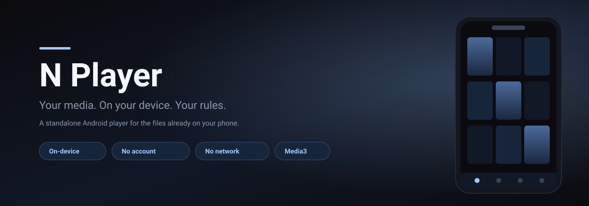
</picture>

[](https://github.com/NSKWeb/NPlayer/actions/workflows/android.yml)
[](https://github.com/NSKWeb/NPlayer/releases/latest)
[](LICENSE)
[](#install)
[](NPlayer)
[](NPlayer)

**Kotlin · Jetpack Compose · Media3 · Hilt · Coil · min SDK 26**

</div>

---

N Player plays the video and audio already on your device. It reads them straight from
Android's own media library, so there is nothing to sign in to: no server URL, no
username, no password, and no network access. Install it, grant one permission, and your
files are there.

<div align="center">

<picture>
  <source media="(prefers-color-scheme: dark)" srcset="docs/features-dark.svg">
  <source media="(prefers-color-scheme: light)" srcset="docs/features-light.svg">
  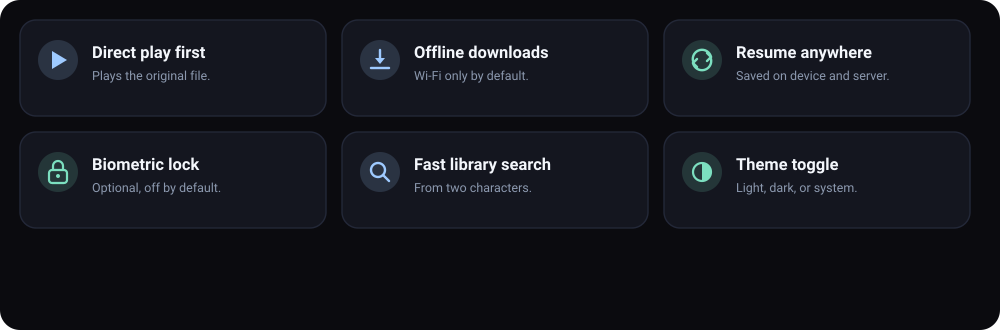
</picture>

</div>

## What's new in 1.1.4

1.1.4 fixes three smaller player issues.

| Change | What it means |
| --- | --- |
| **The gesture hint clears itself** | The brightness, volume and seek hint that appears while you drag now fades out shortly after the gesture ends, instead of staying on the video until you tap it away. |
| **Picture-in-picture keeps the video's shape** | The small window now matches the aspect ratio of the video playing, instead of always being a 16:9 box. |
| **The equalizer binds when audio starts** | The equalizer previously attached at service start, before the player had an audio session, so it could stay unbound and appear to do nothing. It now attaches as soon as the audio session exists. |

## What's new in 1.1.3

1.1.3 fixes fullscreen playback and background playback.

| Change | What it means |
| --- | --- |
| **Fullscreen playback** | The status and navigation bars are now hidden while the player is open, and the video fills the whole screen instead of sitting inside the system bar insets. The bars come back when you leave the player. |
| **No more background playback** | Closing NPlayer from the recents list now stops playback and removes the notification, instead of carrying on in the background until you force stop it. |
| **The APK is padded to 7 MB** | The release APK is padded to exactly 7 MB on purpose, by a placeholder asset under `assets/release/`. Code minification and resource shrinking stay on, so nothing functional is stripped; the padding only affects the download size. Regenerate it with `tools/pad_asset.py`. |

## What's new in 1.1.2

1.1.2 simplifies the player controls.

| Change | What it means |
|---|---|
| **Simpler player controls** | The +20m, +40m, −20m and −40m quick-jump row has been removed. The ±10 s buttons and the scrubber remain, so the transport row is less crowded. |

## What's new in 1.1.1

1.1.1 fixes thumbnails that looked missing and brings the screenshots on this page in
line with the Play Store listing.

| Change | What it means |
|---|---|
| **Thumbnails show up** | Cards were pulling the frame at the very start of the file, which is black in a lot of encodes, so they looked blank against the dark card. They now take a frame from a little way into the video, and a file that cannot be decoded falls back to the placeholder icon instead of an empty box. |
| **One set of screenshots** | The Screens section below now shows the same images prepared for the store listing. |

## What's new in 1.1.0

1.1.0 is a design and smoothness pass, plus the long-jump controls that were missing
from the player.

| Change | What it means |
|---|---|
| **Jump 20 / 40 minutes** | The player now has a quick-jump row next to the ±10 s buttons: **+20m, +40m, −20m, −40m**, for skipping through a long film without dragging the scrubber. |
| **Time remaining** | The seek bar shows the time left (`−1:23:45`) as well as the position, so the length of a file is readable at a glance. |
| **The app's own look** | A deep near-black palette with a cool blue accent and heavier headings, so your thumbnails are the brightest thing on screen. |
| **Match my wallpaper** | Dynamic colour (Material You) is now a **setting**, off by default, so the app keeps its own identity unless you ask for the wallpaper palette. |
| **Better cards** | Rounded poster cards with a duration pill and a soft scrim, section headings with counts, and a filled/outlined bottom bar. |
| **Stops when it is done** | The player service now ends itself when a file finishes with nothing queued, so the app does not linger in the background after you close it. |
| **Subtitles, found for you** | Subtitle files sitting next to a video are picked up automatically, embedded text tracks are listed too, and the Subtitle button turns them on and off and lets you choose. |

## What's new in 1.0.2

1.0.2 fixes playback, which did not start at all in 1.0.0 and 1.0.1, and makes the
shipped build much smaller and smoother.

| Change | What it means |
|---|---|
| **Playback actually starts** | Connecting to the media service was blocking the main thread, so the handshake never completed and Play did nothing. It now suspends instead. |
| **Smaller download** | The published APK is the minified release build: about 3.6 MB instead of 24 MB, with every feature intact. |
| **Smoother first run** | A baseline profile is installed so the startup and scroll paths are compiled ahead of time. |
| **Less repeated work** | Screens that read the library more than once now reuse one filtered pass instead of re-scanning the whole list. |

## What's new in 1.0.1

> [!IMPORTANT]
> **The Jellyfin client is gone.** N Player no longer connects to a server. It plays the
> video and audio already on your device — no URL, no username, no password, and no
> network access. If you used an earlier build to stream from a Jellyfin server, that
> workflow has been removed; this is a standalone local player now.

1.0.1 closes the two known gaps from the 1.0.0 folder work and fixes a navigation and a
privacy bug found while verifying it:

| Change | What it means |
|---|---|
| **Real folders on Android 8–9** | On API 26–28, where `RELATIVE_PATH` does not exist, the containing folder is derived from the legacy `DATA` column, so older devices get a real tree instead of one flat list. |
| **Android paths tested without a device** | Robolectric drives the real repository against a fake MediaStore on API 29 and 28, and the private-folder filtering is tested against the real stores. |
| **Player route fix** | The player route now declares its optional `playlist` argument, so opening the player from a playlist matches the destination instead of failing. |
| **Private items can't leak** | Favourites, playlists, and the playback queue now resolve items through a visibility check, so a hidden file cannot reappear through a stale favourite or playlist entry. |

### The 1.0.0 feature set

| Change | What it means |
|---|---|
| **No server, no account** | The sign-in screen is gone. There is nothing to configure. |
| **Local library** | Videos and audio are read from Android's own MediaStore, newest first. |
| **Folder browsing** | A Folders tab walks the device tree with a breadcrumb trail, so files outside the top level are reachable. |
| **Playlists** | Group videos and tracks into named playlists; playing one queues the whole list. |
| **On-device resume** | Positions are saved every five seconds and restored on Play; nothing is uploaded. |
| **Favourites** | Star any file and it collects on the Favourites tab. |
| **Private folder** | Hide any item behind a biometric check; hidden items vanish from every other list. |
| **Light / dark / system** | A segmented theme control in Settings, remembered across launches. |
| **Player controls** | A full controls overlay: gestures, 0.25x–4x speed, aspect ratio, A–B repeat, sleep timer, repeat/shuffle, screen lock, mirror, night mode, auto-rotate, and subtitle attach. |
| **No `INTERNET` permission** | The app cannot make a network request, by design. |
| **Smaller dependency set** | Room, Retrofit, OkHttp, Gson, WorkManager, and mediarouter were removed. |

### Player controls

The player was rebuilt around a Compose controls overlay instead of the stock Media3
`PlayerView` chrome. It keeps the on-device, offline character of the app — everything
below is local playback control, no network involved.

| Control | How it works |
|---|---|
| **Gestures** | Double-tap left/right to seek ∓10 s; drag horizontally to scrub; drag vertically on the left half for brightness and the right half for volume. |
| **Playback speed** | 0.25x–4x presets, applied to the Media3 player. |
| **Aspect ratio** | Cycles Fit → Fill → Zoom → Stretch. |
| **A–B repeat** | First press marks A, second marks B, third clears; playback loops between them. |
| **Sleep timer** | Pauses playback after 5–90 minutes, with a countdown in the overlay. |
| **Repeat / shuffle** | Off / all / one, and shuffle, mapped onto Media3 repeat and shuffle modes. |
| **Screen lock** | Freezes the touch layer so an accidental tap can't stop playback; a single unlock button remains. |
| **Mirror** | Flips the video horizontally. |
| **Night mode** | Dims the video with a translucent overlay. |
| **Auto-rotate** | Cycles the window between auto, landscape, and portrait. |
| **Picture-in-picture** | Shrinks the video into a floating window that keeps playing over other apps. |
| **Equalizer** | Device presets and per-band sliders, bound to the player's audio session. |
| **Subtitles** | Lists the subtitle files sitting next to the item and any text track inside it, shows the one you pick, and turns subtitles off again. |

### Subtitles

Subtitles are found automatically. When an item opens, the app looks for subtitle files
in the same folder whose name matches the media — `Trip.2024.en.srt` belongs to
`Trip.2024.mp4` — and lists any text track already inside the container as well. A
recognised language tag becomes the label, so `Trip.2024.en.srt` is listed as
"English". If there is exactly one sidecar, it is shown straight away.

The **Subtitle** button in the controls row opens a sheet listing every track with a
marker for whether it is a sidecar file or embedded. Choosing one shows it; **Turn
off** hides it; **Open a file…** attaches one the app did not find. Only one subtitle
is shown at a time. A file the viewer turns off stays off until they turn it back on,
so auto-select does not fight them.

Detection is name-based and local: it reads the device's own file index and never goes
to the network. Formats follow what the Media3 extractors can read — SRT, WebVTT, SSA/
ASS, and TTML. A `.sub` file is deliberately not offered, because it is usually
MicroDVD, which the extractor cannot parse.

Still open: a subtitle *downloader* (it would need `INTERNET`) and true all-format
decoding (RMVB/WMV/DivX would need FFmpeg).

## Install

> [!IMPORTANT]
> **Android 8.0 (Oreo) or newer.** The app targets `minSdk 26`. There is no Play Store
> listing, so every route below is a sideload. iOS is not supported.

<div align="center">


**Scan to download · or open [nskweb.github.io/NPlayer](https://nskweb.github.io/NPlayer/) on the phone**

</div>

> [!TIP]
> **The one-tap page is the easiest route.** [nskweb.github.io/NPlayer](https://nskweb.github.io/NPlayer/)
> is a single button that downloads the newest APK, with the install steps and the
> common warnings answered inline. No account, no store, no file hunting.

| Route | How |
|---|---|
| **Direct download** | Scan the code, or open the [latest release](https://github.com/NSKWeb/NPlayer/releases/latest) *on the phone* and tap `NPlayer.apk` |
| **adb** | From a computer with the phone plugged in: `adb install -r NPlayer.apk` |
| **Build it** | `cd NPlayer && ./gradlew :app:assembleDebug` — see [Build](#build) |

### On your phone

The direct download is the usual path. Scanning the QR opens
`github.com/NSKWeb/NPlayer/releases/latest/download/NPlayer.apk`, which always points
at the newest release asset, so the code never goes stale.

1. **Scan the QR** with the phone's camera, or open the release page in the phone's
   browser. The file lands in **Downloads**.
2. **Tap the downloaded `NPlayer.apk`** — from the notification, or Files → Downloads.
3. **Android will refuse the first time.** It shows *"For your security, your phone is
   not allowed to install unknown apps from this source."* Tap **Settings**.
4. **Allow this source.** You land on *Install unknown apps*; enable it for whichever
   app you downloaded with (Chrome, Firefox, Files). Android 8+ grants this
   **per app**, not globally, and only for the app that opens the APK.
5. **Go back and tap Install.** Play Protect may warn that it does not recognise the
   app. Choose **Install anyway** — see the note below for why.
6. **Open N Player** and tap **Allow access** when it asks for your media. That is the
   only setup step there is.

> [!NOTE]
> **Why Play Protect warns.** Releases are signed with a debug key, not a published
> release key, so Play Protect has never seen the signature before. The warning is
> about *provenance*, not a detected threat. If you would rather verify the build
> yourself than trust the binary, [build it from source](#build) instead — you get an
> APK you compiled.

### If the install is blocked

| Symptom | Fix |
|---|---|
| *"App not installed"* | An older build with the same application id is present — uninstall it first |
| *"There was a problem parsing the package"* | The download is incomplete. Re-download; check the file is ~3.6 MB |
| *"Blocked by Play Protect"* | Tap *Install anyway*, or temporarily turn off scanning in the Play Store's Play Protect settings |
| Tapping the APK does nothing | You opened it from a file manager without permission — grant *Install unknown apps* to that file manager |
| Install option is greyed out | Some OEMs also require disabling *MIUI optimisation* / *Auto Blocker*; check the vendor's sideload settings |

The release build is minified and resource-shrunk, so the download is about 3.6 MB
rather than the ~24 MB a debug build would be — same features, far less to install.
It installs as `com.example.nplayer`.

## The media permission

N Player shows nothing until it can read your media, and the Home screen asks for that
on first launch. The request is the minimum the platform offers:

| Android version | Permission requested |
|---|---|
| **13+ (API 33+)** | `READ_MEDIA_VIDEO` and `READ_MEDIA_AUDIO` |
| **8–12 (API 26–32)** | `READ_EXTERNAL_STORAGE` |

These are read-only grants. The app cannot write, move, or delete your files, and it
does not declare the `INTERNET` permission at all, so it has no way to send anything
anywhere even if it wanted to.

If you decline, Home explains what the permission is for and offers an **Allow access**
button to ask again. Nothing is scanned until you grant it.

<div align="center">
  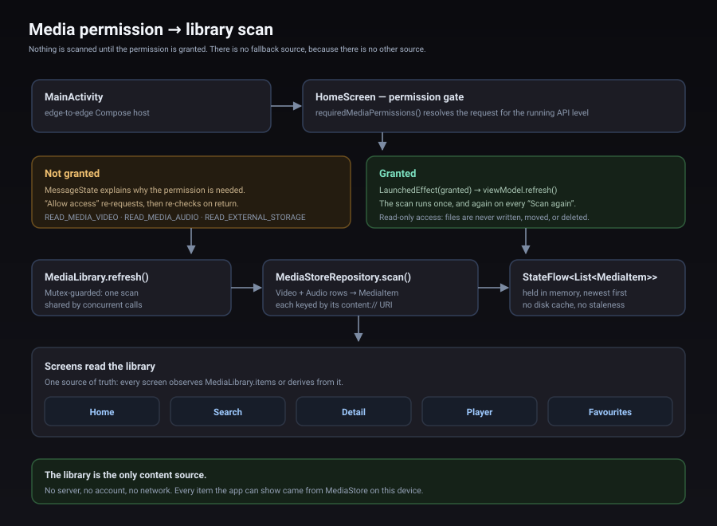
</div>

## Screens

<div align="center">

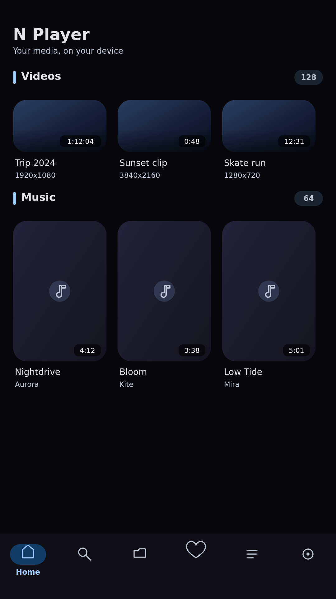
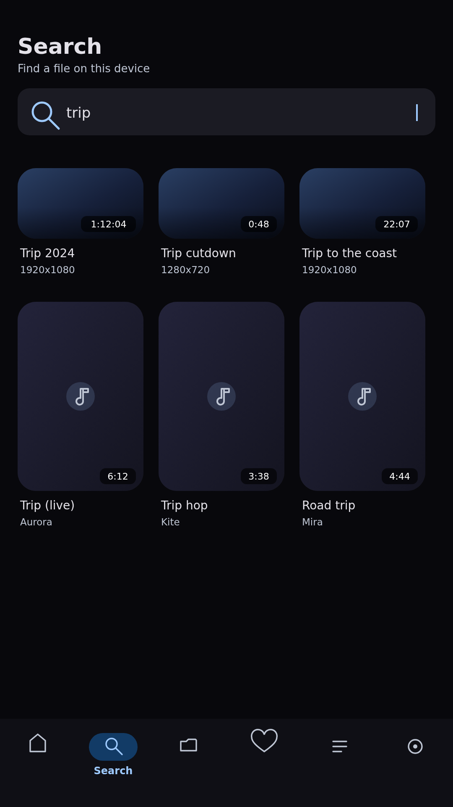
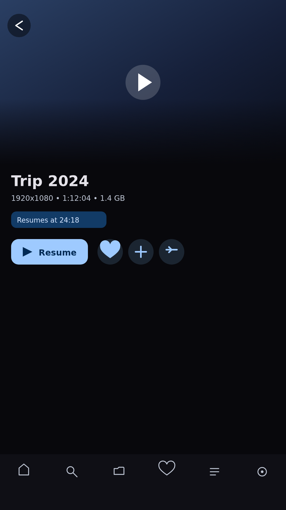

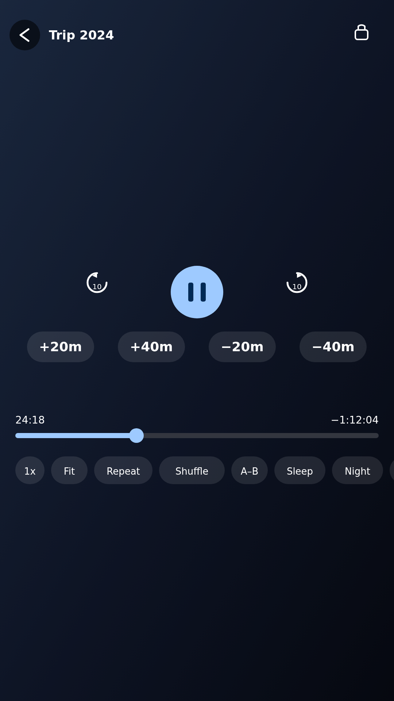
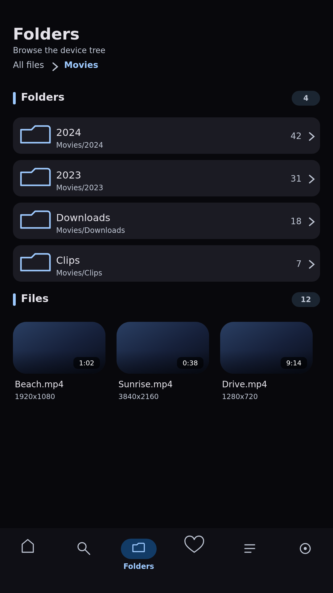
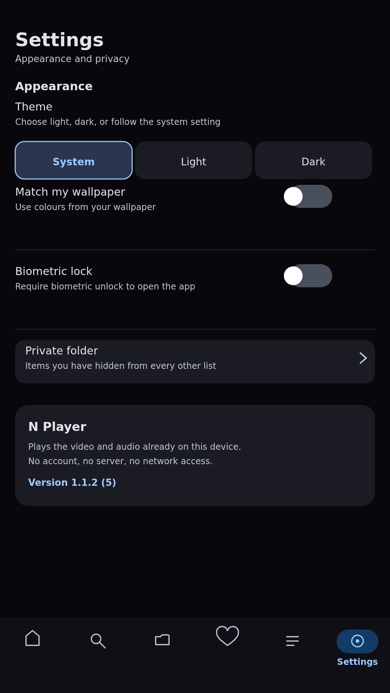

</div>

These are the same images prepared for the Play Store listing, so the README and the
store show one consistent set. They are generated by
`docs/store/generate_screenshots.py`; run it to regenerate them after a UI change.

> [!NOTE]
> **These are accurate mockups, not photographs of a running device.** They are
> rendered from the real Compose layouts, theme tokens, and navigation structure. This
> project was built and verified by compilation, lint, and unit tests in a headless
> environment with no KVM, so no emulator screenshot could be captured. The layouts,
> colours, and copy match the code; real screenshots will replace them once the app has
> been run on a device.

<details>
<summary>Earlier hand-drawn SVG mockups</summary>

<div align="center">

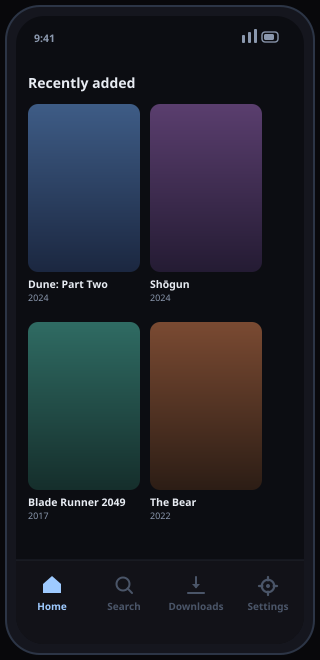
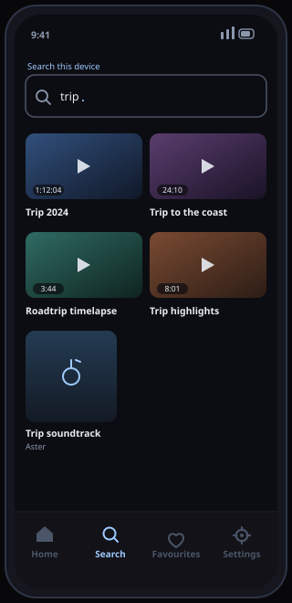
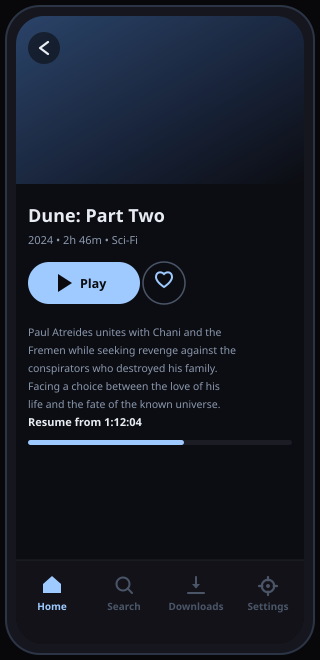
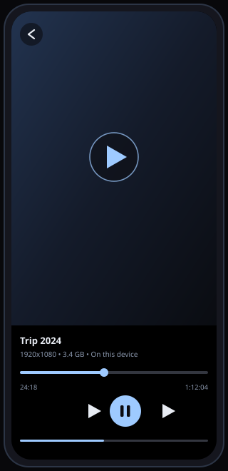
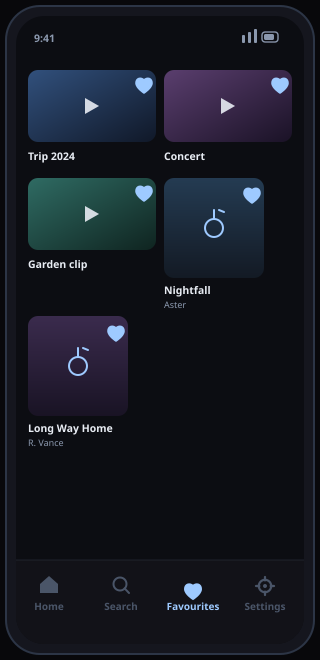
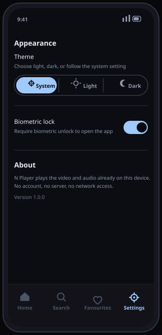

</div>

</details>

## Screens at a glance

| Screen | What it does | State source |
|---|---|---|
| **Home** | Requests the media permission, then lists videos and music found on the device | `HomeViewModel` |
| **Search** | Filters the on-device library by title, artist, or album, from two characters | `SearchViewModel` |
| **Detail** | Thumbnail, file metadata, a Play or Resume button, and a favourite toggle | `DetailViewModel` |
| **Player** | Compose controls overlay over the video surface: gestures, speed, aspect, A–B repeat, sleep timer, and more | `PlayerViewModel` |
| **Folders** | Browses the on-device tree: a breadcrumb trail, sub-folders with recursive counts, and the files directly inside | `FoldersViewModel` |
| **Playlists** | Named lists of videos and tracks; opening one plays the list as a queue | `PlaylistsViewModel`, `PlaylistDetailViewModel` |
| **Favourites** | Everything you have starred, in one grid | `FavouritesViewModel` |
| **Private folder** | Items hidden behind a biometric check, absent from every other list | `PrivateFolderViewModel` |
| **Settings** | Light/dark/system theme, biometric lock, a link to the private folder, and about | `SettingsViewModel` |

The bottom bar carries Home, Search, Folders, Playlists, Favourites, and Settings. Detail,
Player, playlist detail, and the private folder are full-screen destinations pushed on
top, which is why the bar hides for them.

## Architecture

Four layers, one direction of dependency. Compose talks to ViewModels; ViewModels talk
to the library and the preference stores; those own MediaStore and DataStore. Nothing
above the data layer knows about cursors, and nothing below the UI layer knows about
Compose.

<div align="center">
  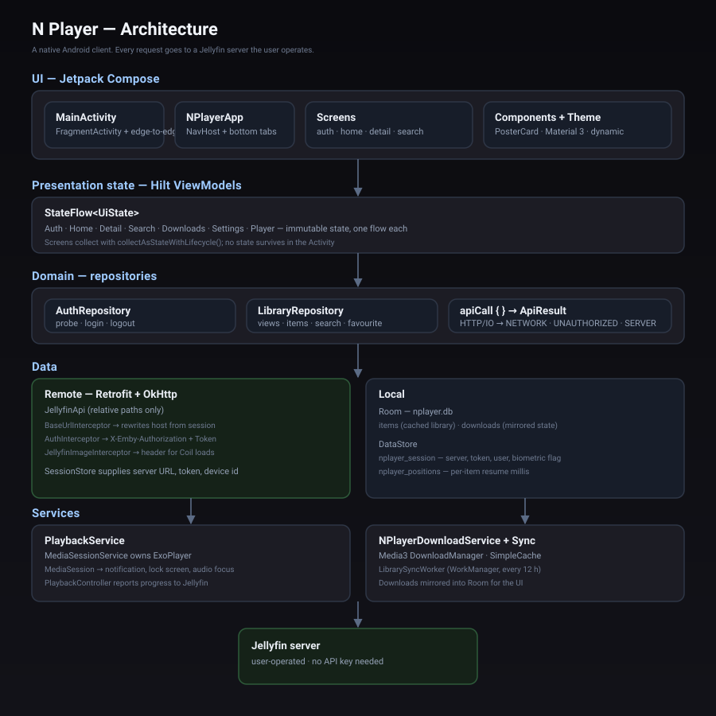
</div>

```
NPlayer/app/src/main/java/com/example/nplayer/
├── data/
│   ├── media/        MediaStoreRepository (scan), MediaLibrary (cache), MediaItem,
│   │                 FolderTree (path and breadcrumb helpers)
│   ├── prefs/        AppSettingsStore, PlaybackPositionStore, ThemeMode
│   └── playlists/    Playlist, PlaylistCodec (serialisation), PlaylistStore
├── playback/         PlaybackService (MediaSessionService), PlaybackController,
│                     PlayerSettings (pure helpers: speed, clocks, A–B model),
│                     EqualizerController and EqualizerSettings (audio effects)
└── ui/               Compose: theme, navigation, components, and the screens
```

### Reading the library

<details>
<summary>Why MediaStore, and why the cache is only in memory</summary>

`MediaStoreRepository` queries `MediaStore.Video` and `MediaStore.Audio` in one pass and
maps each row to a `MediaItem` keyed by its `content://` URI. That URI is the whole
contract: ExoPlayer can play it directly, and Coil can decode a frame from it for a
thumbnail.

`MediaLibrary` holds the result in a `StateFlow` and re-scans on demand. A MediaStore
query is cheap, so the cache is deliberately memory-only — persisting it would add
staleness and a schema for no real gain. A `Mutex` means concurrent refresh requests
share a single scan instead of stampeding the content resolver.

</details>

### Video thumbnails

<details>
<summary>Coil needs a decoder registered for video files</summary>

Coil does not know how to read a video by default. `NPlayerApplication` implements
`ImageLoaderFactory` and registers `VideoFrameDecoder`, which decodes a representative
frame from the `content://` video URI. Without it, a video tile would render blank.
Audio has no visual, so its tiles show a music glyph instead.

</details>

## Playback

Playback lives behind a Media3 `MediaSessionService`. The Activity and ViewModel never
hold an `ExoPlayer`; they hold a `MediaController` bound to the service. That is what
gives background playback, the media notification, lock-screen controls, and correct
audio focus for free.

<div align="center">
  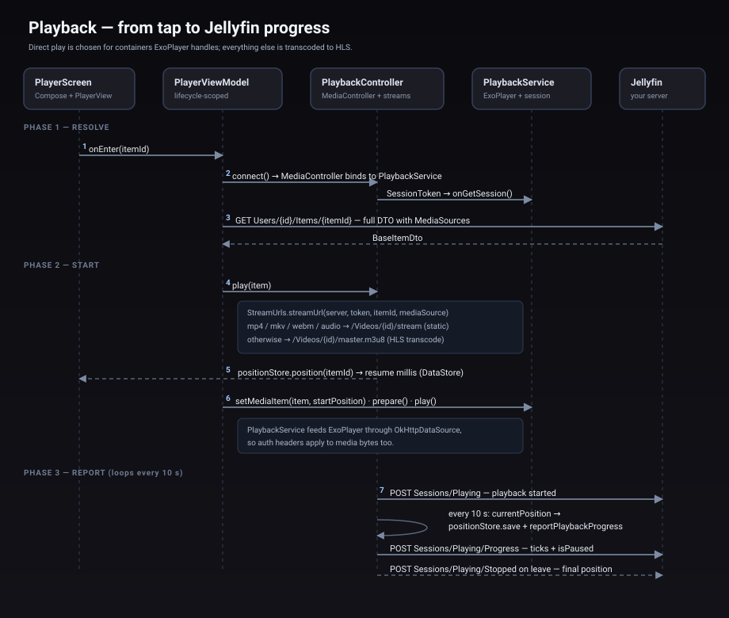
</div>

Because every source is a local `content://` URI, `PlaybackService` builds ExoPlayer on
a plain `DefaultDataSource` — there is no HTTP data source and no auth header to attach.
There is also no transcode decision to make: the file is played as it is, exactly what
the device stored.

### Controls overlay

The player screen does not use `PlayerView`'s built-in controller. It sets
`useController = false` and draws a Compose overlay instead, so gestures, the aspect
selector, A–B repeat, the sleep timer, and the rest live in one place and stay in sync
with `PlayerViewModel`. The view is still a `PlayerView` for the video surface, but its
own subtitle view is hidden: captions are drawn by the Compose overlay, which keeps
them on screen when the controls auto-hide.

The overlay reads player state by polling — Media3 has no reactive clock — and applies
gesture brightness to the Activity window, restoring the previous value when the screen
leaves.

### Finding subtitles

`MediaStoreRepository.scanSubtitles()` reads the device's file index once per library
refresh and keeps the subtitle files keyed by name. When an item opens, `MediaLibrary`
picks the sidecars in its folder whose name matches the media, and `PlaybackController`
attaches them to the Media3 item as `SubtitleConfiguration`s alongside any text track
already in the container. The matching and label rules live in `data/media/
SubtitleFiles.kt` and are unit-tested; only the Media3 calls around them touch the
device.

### Resume position

<details>
<summary>Kept on the device, and only on the device</summary>

`PlaybackPositionStore` keeps a per-item position in DataStore (`nplayer_positions`).
`PlaybackController` restores it as the start position when you press Play, and a loop
saves the current position every five seconds while playing. Leaving the player cancels
the loop and saves once more.

There is no server to report progress to, so the position never leaves the phone. The
Detail screen surfaces it as a **Resume** button when a saved position exists.

</details>

## Design

<div align="center">
  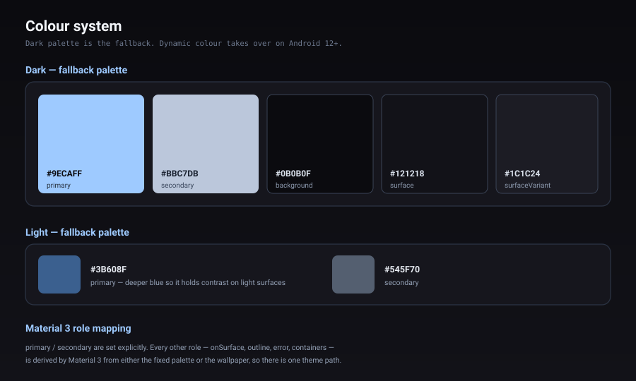
</div>

### Colour

The app leans dark. The fallback palette sets a near-black canvas (`#0B0B0F`) with a
soft blue primary (`#9ECAFF`), which keeps video thumbnails the brightest thing on
screen — the correct hierarchy for a media browser. `Theme.NPlayer` also paints the
window background to match, so there is no white flash between the splash and the first
frame.

On Android 12 and above, **dynamic colour is on by default** and the app inherits the
user's wallpaper palette. The fixed palette is the fallback for older devices, and
Material 3 derives the remaining roles from either source.

**Light, dark, or system** is a real choice, not a device-only default. Settings exposes
a segmented control that writes a `ThemeMode` to DataStore:

| Mode | Behaviour |
|---|---|
| **System** (default) | Follows the device setting. |
| **Light** | Always the light scheme, regardless of the device. |
| **Dark** | Always the dark scheme. |

`MainActivity` reads the stored mode *before* `NPlayerTheme` is applied, so the choice
survives process death and there is no light-to-dark flash on launch.

### Layout and components

- **`PosterCard`** renders a video at 16:9, the shape of its own frame, and an audio
  track at 2:3. It takes any image model, so a `content://` URI and a placeholder glyph
  use the same card.
- **The grids** use `GridCells.Adaptive(minSize = 120.dp)`, so a phone shows two or
  three columns and a tablet shows more, from the same code.
- **`LoadingBox` and `MessageState`** are shared, so every screen has identical loading
  and empty-state behaviour instead of six different ones.
- **Edge-to-edge** is enabled in `MainActivity`; the `Scaffold` supplies insets, and
  `NavHost` receives the inner padding so content never sits under the system bars.

## Security and privacy

- **No network.** The app does not request the `INTERNET` permission. The only network
  permission present, `ACCESS_NETWORK_STATE`, is merged in automatically by
  `media3-common` and lets the player react to a network change; it grants no ability to
  open a connection. Nothing you play or watch is uploaded, because there is nowhere for
  it to go.
- **Read-only media access.** `READ_MEDIA_VIDEO`, `READ_MEDIA_AUDIO`, or
  `READ_EXTERNAL_STORAGE` — enough to list and play your files, and no more.
- **Optional biometric lock.** When enabled, `BiometricGate` hides all content behind
  `BiometricPrompt` using `BIOMETRIC_WEAK` or device credential. It is off by default
  and only protects the app on the device it is installed on.
- **Everything stays on the phone.** Favourites, theme choice, the lock setting, and
  resume positions live in the app's own DataStore. There is no account, no token, and
  no telemetry.

## Hosting the APK

You do not need a server to ship this. GitHub hosts the release asset for free, and
that is what the download link and QR code point at.

### GitHub Releases — the current setup

Publishing is automated. `.github/workflows/release.yml` builds the debug APK and
publishes it whenever a `v*` tag is pushed, so releasing a new build is one command:

```bash
git tag -a v1.0.1 -m "N Player v1.0.1"
git push origin v1.0.1
```

The workflow checks out the tagged commit, builds `:app:assembleRelease`, and then either
creates the release or updates the existing one — re-running a tag refreshes its asset
with `--clobber` rather than failing. To re-publish a tag without a new commit, run the
**Release** workflow from the Actions tab and supply the tag name.

The APK is published as a release asset, so the download URL is stable across versions:

```
https://github.com/NSKWeb/NPlayer/releases/latest/download/NPlayer.apk
```

That `latest/download/<asset>` form always resolves to the newest release, so the link
and the QR code never need updating.

<details>
<summary>Publishing by hand, without the workflow</summary>

If you would rather not tag, or the workflow is unavailable, publish from a local build.
The asset keeps its plain name so the stable link above stays valid:

```bash
cd NPlayer
./gradlew :app:assembleDebug

gh release create v1.0.1 \
  app/build/outputs/apk/debug/NPlayer.apk \
  --title "N Player 1.0.1" --notes "…"
```

Or via the API — create the release, then upload the asset:

```bash
# 1. create the release, note the returned id
curl -X POST -H "Authorization: token $GITHUB_TOKEN" \
  https://api.github.com/repos/NSKWeb/NPlayer/releases \
  -d '{"tag_name":"v1.0.1","name":"N Player 1.0.1"}'

# 2. upload the APK to that release id
curl -X POST -H "Authorization: token $GITHUB_TOKEN" \
  -H "Content-Type: application/vnd.android.package-archive" \
  --data-binary @app/build/outputs/apk/debug/NPlayer.apk \
  "https://uploads.github.com/repos/NSKWeb/NPlayer/releases/<ID>/assets?name=NPlayer.apk"
```

</details>

Because releases are versioned, users can also browse older builds under
[Releases](https://github.com/NSKWeb/NPlayer/releases).

### Other hosting options

| Option | Best for | Trade-off |
|---|---|---|
| **GitHub Releases** *(in use)* | Free, versioned, stable URL, no infrastructure | Debug-key signed; not on Play |
| **GitHub Pages** | A small download landing page | You must commit the APK, or host it on Releases and link to it — a binary in git bloats history |
| **Play Store** | Wide distribution, auto-updates | Requires a release keystore, an app bundle, a privacy policy, and review |
| **F-Droid** | Open-source Android catalogue | Requires fully reproducible builds and a public signing setup |
| **Self-hosted / S3 / Cloudflare R2** | Private or internal distribution | You own the bandwidth, TLS, and uptime |

## Publishing to the Play Store

This is the full path from this repo to a live listing. It is deliberately step by step:
each step produces something you can check before moving on.

### 1. Create a release keystore

Play will not accept a debug-signed build, and you must keep this key for the life of
the app — every future update has to be signed with the same one.

```bash
keytool -genkeypair -v \
  -keystore nplayer-release.jks \
  -alias nplayer \
  -keyalg RSA -keysize 4096 -validity 10000
```

Answer the prompts, then keep `nplayer-release.jks` and its passwords somewhere safe
(a password manager plus an offline backup). If you lose it you cannot update the app.

### 2. Point the build at the keystore

Create `NPlayer/keystore.properties` — it is git-ignored, so the secrets stay local:

```properties
storeFile=/absolute/path/to/nplayer-release.jks
storePassword=…
keyAlias=nplayer
keyPassword=…
```

`app/build.gradle.kts` already reads this file and switches the release build to a real
signature when it is present; with no file it falls back to the debug key, which is what
makes the GitHub release installable.

### 3. Build an Android App Bundle

Play distributes `.aab`, not `.apk`:

```bash
cd NPlayer
./gradlew :app:bundleRelease
```

The bundle lands at `app/build/outputs/bundle/release/app-release.aab`. Play then
generates per-device APKs from it, which is smaller for users than one universal APK.

### 4. Set an application id you own

The id is permanent once published. `com.example.nplayer` is fine for sideloading but
looks unfinished on a store — change `applicationId` in `app/build.gradle.kts` (and the
`namespace`) to something you control, e.g. `dev.nskweb.nplayer`, **before** the first
upload. Afterwards you cannot change it.

### 5. Write the store listing assets

You need, ready to upload:

| Asset | Requirement |
|---|---|
| App name | 30 characters max |
| Short description | 80 characters max |
| Full description | 4000 characters max |
| App icon | 512×512 PNG, 32-bit |
| Feature graphic | 1024×500 PNG |
| Phone screenshots | 2–8 images, 16:9 or 9:16, min 320 px on the short side |

The listing copy is written and the images are generated:

- `docs/store/listing.md` — app name, short description, full description, and the
  data-safety answers, ready to paste into Play Console.
- `docs/store/screenshots/` — `feature-graphic.png` (1024×500) and six phone
  screenshots (1080×1920). Regenerate them with `python docs/store/generate_screenshots.py`.

Still to add by hand: the 512×512 app icon, exported from `NPlayer/app/src/main/
res/mipmap-anydpi-v26/ic_launcher.xml` or the source artwork.

### 6. Write a privacy policy

Play requires a reachable privacy-policy URL. N Player is easy to describe honestly:
it reads your media through Android's MediaStore, requests **no** `INTERNET`
permission, and sends nothing off the device. A single static page stating that is
enough — GitHub Pages is a fine host.

### 7. Create the app in Play Console

1. Go to [play.google.com/console](https://play.google.com/console) and create a
   developer account (one-time fee).
2. **Create app**, set the default language, app name, and choose *App* (not game).
3. Fill in **App content**: privacy policy URL, ads (none), data safety (no data
   collected or shared), target audience, and content rating questionnaire.
4. Complete the **Data safety** form carefully — because there is no network access,
   you can declare that no data is collected, which is a genuine selling point.

### 8. Upload and roll out

1. **Testing → Internal testing → Create new release**, upload `app-release.aab`.
2. Add yourself as a tester, install from the opt-in link, and confirm playback,
   permissions, and the background behaviour on a real device.
3. Promote to **Closed**, then **Open** testing if you want a wider check.
4. **Production → Create new release**, upload the same bundle, write release notes,
   and roll out. First review usually takes a few days.

### 9. Ship updates

Bump `versionCode` (must increase every upload) and `versionName` in
`app/build.gradle.kts`, then repeat step 8. Play handles delivery and auto-updates from
then on.

> [!NOTE]
> **Play App Signing.** Google re-signs your bundle with its own key by default and
> holds the app-signing key for you. Your `nplayer-release.jks` then acts as the
> *upload* key. This is the recommended setting — losing an upload key can be
> recovered, losing an app-signing key cannot.

## Publishing to F-Droid

F-Droid builds from source and publishes its own signature, so there is nothing to
upload by hand. To be listed you need a public source repo, a permissive licence (this
project is MIT), and no proprietary dependencies or tracking. Add an
[`fdroiddata`](https://gitlab.com/fdroid/fdroiddata) metadata file
(`metadata/dev.nskweb.nplayer.yml`) with the repo URL, build recipe
(`./gradlew :app:assembleRelease`), and version tags, then open a merge request. F-Droid
must be able to reproduce the build, so avoid anything that pulls a binary at build time.

## Signing a release

Release signing is driven by `keystore.properties` at `NPlayer/keystore.properties`:

```properties
storeFile=/absolute/path/to/keystore.jks
storePassword=…
keyAlias=…
keyPassword=…
```

When the file is absent the release build is signed with the debug key — that is what
keeps the GitHub release installable with no setup. Add the file (and never commit it)
when you want a real signature, for Play or for a signed direct download.

### Keep the APK out of git

Build output is git-ignored, and it should stay that way — a multi-megabyte binary in
the history is painful to remove later. Publish through Releases instead.

## Repository layout

```
.
├── NPlayer/            Gradle project — open this in Android Studio
│   └── app/src/        Kotlin sources, Compose UI, resources
├── docs/               SVG diagrams and screen mockups used by this README
└── LICENSE
```

## Build

Requirements: JDK 17 or newer (CI uses 21), Android SDK with platform 35 and build-tools 35.

The Gradle project lives in `NPlayer/`, so build from there:

```bash
export ANDROID_HOME=/path/to/android-sdk
cd NPlayer

./gradlew :app:assembleDebug        # debug APK
./gradlew :app:testDebugUnitTest    # unit tests
./gradlew :app:assembleRelease      # minified release APK
```

Debug output lands at `NPlayer/app/build/outputs/apk/debug/NPlayer.apk`.

CI builds and tests on every push and pull request, and uploads the test report and
APK as artifacts.

### Tests

`FolderTreeTest` covers the folder tree: path normalisation, storage-root stripping,
parent and child resolution, recursive counts, and breadcrumbs. `MediaItemFormattingTest`
covers the small formatting helpers that are easy to get wrong and easy to miss: duration
text across the hour boundary and unknown durations, and size text at each unit boundary.
`PlayerSettingsTest` covers the player's pure helpers: speed stepping up and down the
preset ladder, clock formatting under and over an hour, the repeat and resize cycles, and
the A–B repeat's active-state rules. `SubtitleFilesTest` and `SubtitleTracksTest` cover
subtitle matching: which sidecar names belong to which media file, which extensions the
extractors accept, when a file-name tag is a language rather than a release tag, and the
order sidecars and embedded tracks are listed in. `PlaylistCodecTest` covers playlist
serialisation and the duplicate and missing-item rules, and `EqualizerSettingsTest`
covers the millibel range mapping and preset matching. These run on the JVM with no
device, because the helpers are pure functions with no Android dependencies.

Two tests go further and drive the real Android code through Robolectric, still with no
device: `MediaStoreRepositoryTest` runs the repository against a fake MediaStore provider
on both API 29 and API 28 to check the cursor mapping and the legacy `DATA`-column folder
fallback, and `PrivateFolderTest` checks that hiding an item removes it from every listing
while the gated screen still sees it.

### Signing a release

Create `keystore.properties` in `NPlayer/` (git-ignored):

```properties
storeFile=/absolute/path/to/keystore.jks
storePassword=…
keyAlias=…
keyPassword=…
```

When the file is absent the release APK is produced unsigned, so local builds and CI
work without secrets.

## Scope and intent

N Player plays media you already own, stored on the device you are holding. It
deliberately contains no streaming endpoints, no accounts, no analytics, and no network
access of any kind. There is nothing to configure and nothing to sign in to.

## License

[MIT](LICENSE).
